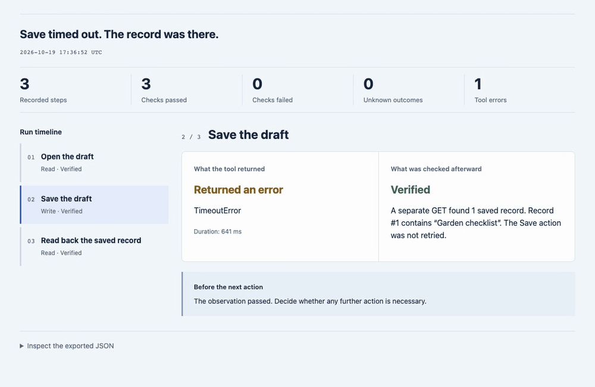
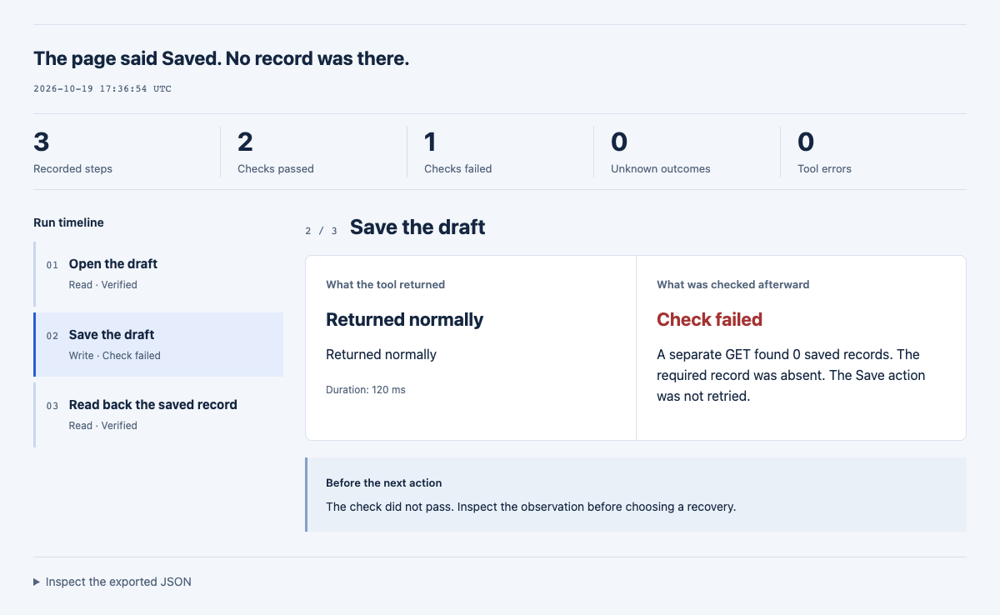
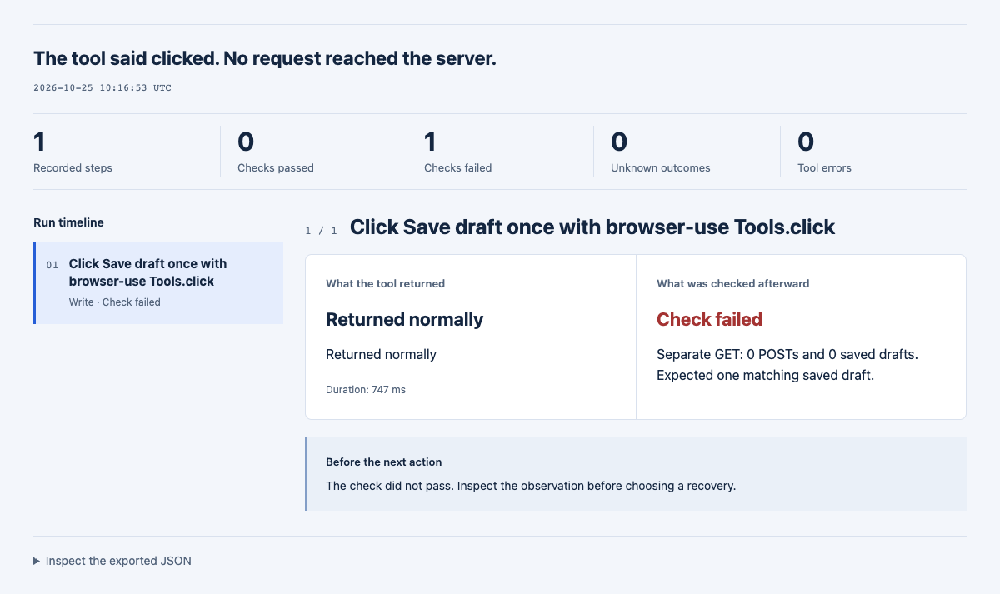
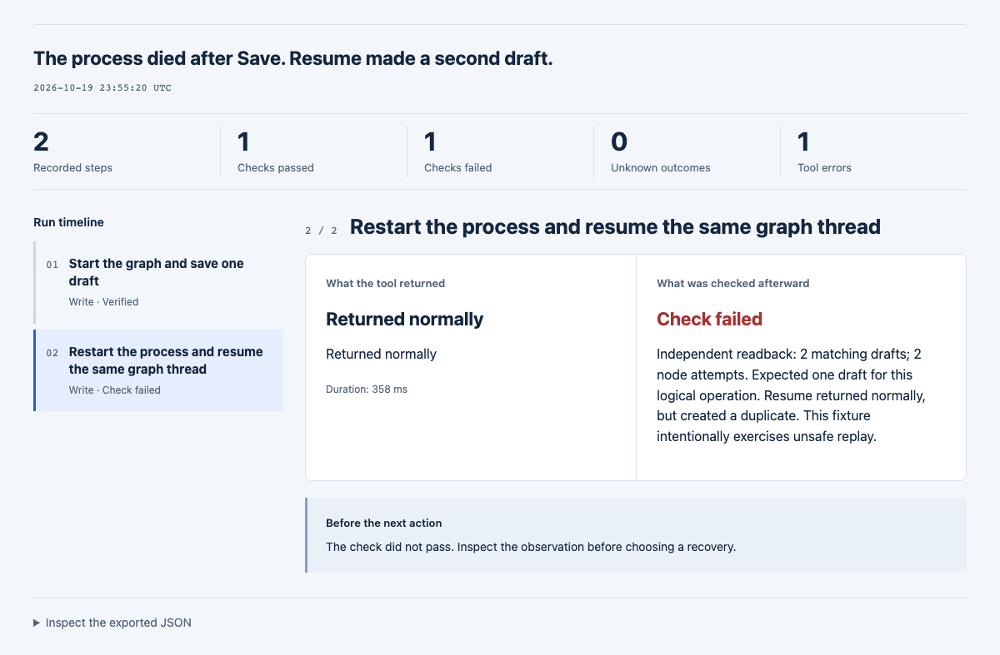
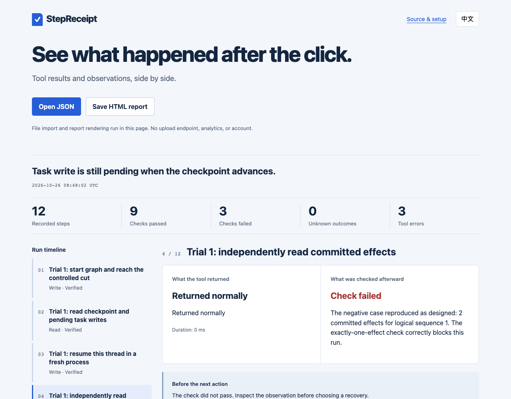
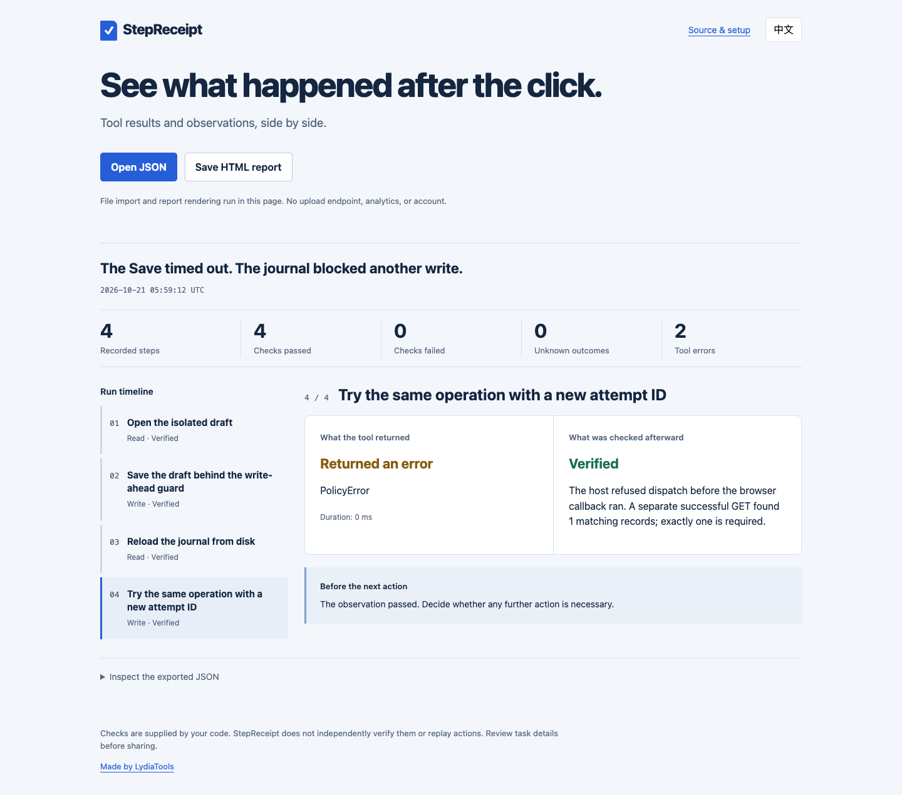
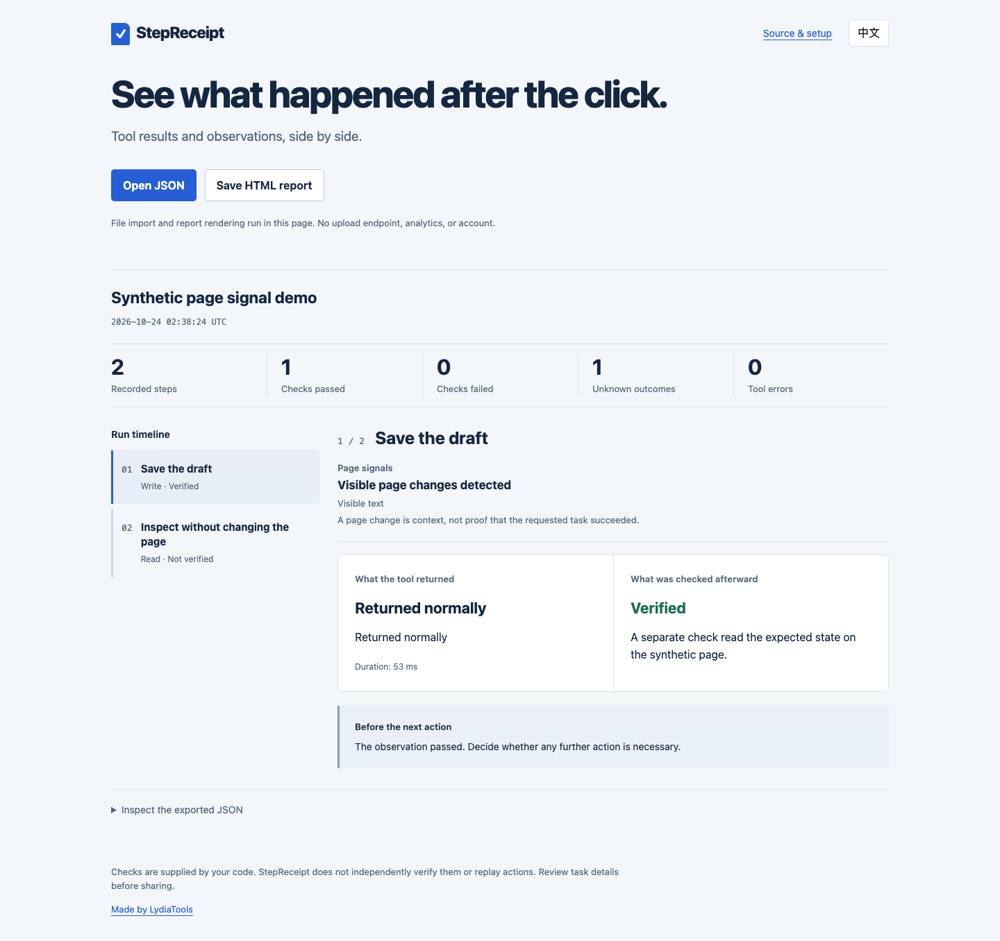

# StepReceipt

**You click Save. The tool times out. Did it save?**

For a moment, you don't know whether to wait, check the page, or click again. One more click might be harmless. It might also create a second draft.

I built StepReceipt for that pause. It puts what the browser tool returned next to what you checked afterward, in a report you can open and share. A timeout can sit beside a successful readback; a normal tool return stays **unknown** until a check says more.

The decision is still yours. The receipt gives you a clearer place to start.

**[Open the live report](https://lydiatools.github.io/stepreceipt/)** · [Python browser-use example](docs/BROWSER-USE.md) · [Stagehand example](docs/STAGEHAND-INTEGRATION.md) · [中文说明](README.zh-CN.md) · [Download a release](https://github.com/LydiaTools/stepreceipt/releases/latest)



*Recorded from the real report viewer using three committed synthetic local-browser runs. Each fixture made one POST with no retry. [Static timeout screenshot](docs/assets/report-focus.png) · [Capture and reproduction notes](docs/DEMO.md).*

## What goes on the receipt

| Question | What StepReceipt records |
| --- | --- |
| What did I ask the tool to do? | A named read or write, its timing, and its tool return status |
| Did the page visibly change? | Optional URL, title, sampled-text, and control-count signals around a Playwright action |
| What did I actually check? | An explicit observation marked `verified`, `rejected`, or `unknown` |
| What can I share for review? | A local JSON file and a self-contained HTML report, with English and Chinese controls |

StepReceipt calls each recorded action once; it does not retry or replay it. You provide the follow-up check, so the report is only as reliable as that check. Other parts of your system can still retry independently.

## See a receipt in a minute

Node.js 20+ is enough to render a report. No install, model, account, or API key is needed for this step:

```bash
git clone https://github.com/LydiaTools/stepreceipt.git
cd stepreceipt
node bin/stepreceipt.mjs examples/save-timeout.json --out receipt.html
```

Open `receipt.html` in your browser. Or open a run JSON in the [online viewer](https://lydiatools.github.io/stepreceipt/). The viewer reads it in the page; there is no upload endpoint or analytics code. GitHub Pages still receives ordinary page requests.

The CLI refuses to overwrite an existing output file. Choose a new filename for another report.

## Install the CLI or library from GitHub

The package is not published to the npm registry. You can install the current GitHub source directly with Node.js 20+ and Git:

```bash
npm install -g github:LydiaTools/stepreceipt
stepreceipt path/to/run.json --out receipt.html
```

To use the recorder in a Node.js project:

```bash
npm install github:LydiaTools/stepreceipt
```

Then import the public entry points:

```js
import { createReceipt } from 'stepreceipt';
import { renderReport } from 'stepreceipt/report';
```

Installing from GitHub avoids implying that the package is available through the npm registry.

## Run the browser example yourself

This example starts its own localhost fixture and a fresh, isolated browser. It does not connect to your signed-in Chrome session or a real site.

```bash
npm ci
npx playwright install chromium
npm run demo
```

If Google Chrome is already installed, you can use it without downloading a browser:

```bash
# macOS / Linux
BROWSER_CHANNEL=chrome npm run demo
```

PowerShell: `$env:BROWSER_CHANNEL="chrome"; npm run demo`.

Open `artifacts/demo/report.html`. The matching `run.json` contains the recorded tool error and the later observation. The expected fixture result is **one write request and one saved record**.

## Put recorded checks in CI

```bash
node bin/stepreceipt.mjs artifacts/demo/run.json --summary receipt-summary.md --check
```

The summary is Markdown, suitable for a GitHub Actions job summary. `--check` exits **0** only when a non-empty run has every observation marked `verified`; **1** for any `rejected`/`unknown` observation or an empty run; **2** for invalid input, arguments, or output errors. A verified readback can accompany a tool error. Generating a report without `--check` does not apply this gate.

The gate evaluates recorded checks; it does not independently inspect your application or prevent a caller from supplying a misleading observation. [CI recipe and boundaries](docs/CI.md).

Three real-browser cases run in `npm run test:e2e`, each against its own synthetic local service:

| Scenario and visible page signal | Separate readback | Recorded-check gate | Actual report |
| --- | --- | --- | --- |
| Timeout after Save; visible text changed | Exactly one matching record | Passed | [Saved after timeout](https://lydiatools.github.io/stepreceipt/) |
| Page says “Saved successfully”; visible text changed | No saved record; storage returned 503 | Blocked | [False confirmation](https://lydiatools.github.io/stepreceipt/cases/rejected-write.html) |
| Timeout after Save; visible text changed | Readback returned 503; count unavailable | Blocked, unknown | [Unavailable readback](https://lydiatools.github.io/stepreceipt/cases/unknown-readback.html) |

Each case makes exactly one POST. Our [actual workflow](.github/workflows/test.yml) adds all three summaries and retains the synthetic HTML/JSON reports as a short-lived Actions artifact. The negative cases are expected to block; the test suite checks their CLI exit codes.



## Python browser-use: clicked does not mean saved

The optional bridge records a real `Tools.click` result beside your application's read-only check. Four original local cases cover a disabled button, a working save, a false success toast and unavailable readback. With the pinned browser-use 0.13.11, all four clicks returned normally; the checks produced **rejected / verified / rejected / unknown**. No model or API key was used.

[Run the four cases](docs/BROWSER-USE.md) · [Open the disabled-click receipt](https://lydiatools.github.io/stepreceipt/browser-use/disabled.html) · [Python bridge](integrations/browser-use/stepreceipt_browser_use.py)



The bridge does not infer success from generated text or retry the action. This tests native tool calls on synthetic pages, not model-driven `Agent.run` behavior or production sites. Included from v0.6.0; older fixed releases do not contain it.

## A real LangGraph process restart

**The graph returned normally. It saved the same draft twice.** An optional, provider-free example kills a Python process after the business commit and resumes the same thread in a new process. Ordinary insert: **2 attempts, 2 drafts**. A target-side unique operation key: **2 attempts, 1 draft**. A completed-node control stays at **1 attempt, 1 draft**.

[Run all three cases](docs/LANGGRAPH.md) · [Open the duplicate report](https://lydiatools.github.io/stepreceipt/langgraph/crash-replay.html) · [Open the target-deduplication report](https://lydiatools.github.io/stepreceipt/langgraph/target-dedup.html). This example is included in v0.3.0; the fixed v0.2.0 ZIP predates it. StepReceipt records the difference; the target database performs the deduplication.



## Reproduce a LangGraph checkpoint-ordering race

**The task write was still held when a newer checkpoint reached the saver boundary.** In a controlled LangGraph 1.2.17 fixture, resume replayed the unfinished action and committed a second effect in all three repetitions. The example also includes a completed baseline, an ordered-write control, and a stable-operation-key control.

[Run the four cases](docs/LANGGRAPH-SYNC-RACE.md) · [Open the replay report](https://lydiatools.github.io/stepreceipt/langgraph-sync-race/race-replay.html) · [Chinese guide](docs/LANGGRAPH-SYNC-RACE.zh-CN.md)



This is an original synthetic SQLite reproduction informed by [LangGraph #8039](https://github.com/langchain-ai/langgraph/issues/8039), which already includes its own reproduction. StepReceipt adds a separate event-gated run with portable reports and explicit controls; it does not patch LangGraph or imply upstream endorsement. The existing [process-restart example](docs/LANGGRAPH.md) covers a different crash point and remains pinned separately.

## Put a recovery gate and a receipt in the same browser run

The [optional Blueprint integration](docs/BLUEPRINT-INTEGRATION.md) connects Browser Agent Blueprint's pinned write-ahead controller to StepReceipt's real browser action, separate readback, CLI gate, and HTML report. It runs three local synthetic cases: a saved draft whose UI confirmation times out, a failed readback that must stay unknown, and an unguarded retry that creates a duplicate. The first two reload the journal into a fresh controller and show whether another dispatch is refused.



[Open the saved-timeout report](https://lydiatools.github.io/stepreceipt/cases/blueprint-saved-timeout.html) · [Open the unknown-readback report](https://lydiatools.github.io/stepreceipt/cases/blueprint-unknown-readback.html) · [Open the unguarded-retry report](https://lydiatools.github.io/stepreceipt/cases/blueprint-unguarded-retry.html)

```bash
npm ci
npx playwright install chromium
npm run demo:blueprint -- --out artifacts/blueprint-demo
```

Open each generated `report.html` and `summary.md` under `artifacts/blueprint-demo/`. The checked-in CI test also captures the actual English and Chinese reports at desktop and mobile sizes. This is a same-process journal reload; the separate [LangGraph example](docs/LANGGRAPH.md) covers a real process restart. Neither local fixture proves behavior on a production website.

[English reproduction guide](docs/BLUEPRINT-INTEGRATION.md) · [中文复现指南](docs/BLUEPRINT-INTEGRATION.zh-CN.md)

## Use it in your Node.js project

After installing the package from GitHub as shown above, import the recorder. It has zero runtime dependencies:

```js
import { createReceipt } from 'stepreceipt';
import { renderReport } from 'stepreceipt/report';
import { writeFile } from 'node:fs/promises';

const receipt = createReceipt({ title: 'Save a draft' });
const step = await receipt.attempt(
  { label: 'Save the draft', kind: 'write' },
  async () => {
    await page.getByRole('button', { name: 'Save' }).click();
    await page.getByText('Saved successfully').waitFor();
  },
);

// Supply a separate read-only check, including after a tool error.
await receipt.verify(step.id, async () => {
  const found = await page.getByText('Draft #42').isVisible();
  return {
    status: found ? 'verified' : 'unknown',
    summary: found ? 'Draft #42 is visible.' : 'Draft #42 was not observed.',
  };
});

await writeFile('run.json', JSON.stringify(receipt.toJSON(), null, 2));
await writeFile('receipt.html', renderReport(receipt.toJSON()));
```

`attempt()` captures an action error and returns `{ id, ok, value }`; it does **not** rethrow the action error. Check `ok`, inspect the observation, and explicitly decide whether the workflow should continue. Observer errors remain `unknown`. Verifying a step a second time is rejected; record a new observation step if you need another check.

### Record page changes around an action

The optional Playwright adapter records whether the URL, title, visible text, or count of interactive elements changed around one action. It stores only the signal names—not the URL, title, page text, or their temporary fingerprints.

For a selector-based click, `recordPageClick` executes through the same Playwright `Page` object it samples and requires a unique match. The caller must still choose the correct page and independently verify the task result. Arbitrary `recordPageAction` callbacks can use a different page; the recorder cannot infer their target. [Playwright guide](docs/PLAYWRIGHT.md)

```js
import { recordPageAction } from 'stepreceipt/playwright';

const step = await recordPageAction(receipt, page, {
  label: 'Save the draft',
  kind: 'write',
  action: () => page.getByRole('button', { name: 'Save' }).click(),
});

// Page change is context. Keep the task-specific check explicit.
await receipt.verify(step.id, async () => {
  const saved = await page.getByText('Draft saved').isVisible();
  return {
    status: saved ? 'verified' : 'unknown',
    summary: saved ? 'The independent check passed.' : 'The expected state was not observed.',
  };
});
```

The page is sampled as soon as the action callback settles. If a site updates asynchronously, await the relevant state inside the callback; the separate task-specific check still determines `verified`, `rejected`, or `unknown`. Capture failure does not prevent the action from running once. No retry or replay is added. A changed page does not prove the requested result happened; a page that looks unchanged may still have an off-screen or server-side effect. [Adapter details and limits](docs/PLAYWRIGHT.md).

See the [synthetic page-signal report](https://lydiatools.github.io/stepreceipt/cases/page-signals.html) and its [English screenshot](docs/assets/page-signals.png) or [Chinese screenshot](docs/assets/page-signals-zh.png). The example pairs a visible change with a separate verified check, then shows an unchanged page whose task outcome remains unknown.



## Try the Stagehand v4.3.0 example

The optional local example records two Stagehand Page clicks and separate checks. It shows a save that changed the page and a click that did not change the requested state. The example uses a synthetic localhost fixture, does not call the model-backed `stagehand.act()` method, requires no model key or Browserbase account, and keeps Stagehand outside StepReceipt's runtime dependencies.

```bash
cd examples/stagehand
npm ci
npm run demo
```

Requires Node.js 22.18+ and local Chrome or Chromium. [Run instructions and result boundaries](docs/STAGEHAND-INTEGRATION.md) · [中文说明](docs/STAGEHAND-INTEGRATION.zh-CN.md).

## What the current source is ready for

- Rendering your recorded actions and checks into a portable review report.
- Opening and exporting run JSON locally in a browser, with no backend.
- Trying the included real-browser timeout/readback fixture.
- Producing Markdown CI summaries and applying a recorded-observation gate, with three reproducible browser cases.
- Connecting a pinned browser write-ahead guard to a separately recorded browser outcome and report.
- Capturing privacy-preserving before/after page signals around one Playwright action.
- Trying the optional Stagehand 4.3.0 Page integration with deterministic clicks and separate outcome checks.
- Recording native Python browser-use action results and explicit checks with the optional single-file bridge and four local cases.
- Keeping raw error messages, stacks, page contents, and network traffic out of automatic capture. Only the error class is recorded.
- Redacting a few common credential patterns from exported text. This is heuristic redaction, not complete detection; labels and observations can still contain private information.

It is not a Playwright `trace.zip` viewer, a cryptographically signed audit trail, or a replacement for site-specific assertions. The Playwright, pinned Stagehand Page and browser-use tool examples use synthetic local pages; production websites, Stagehand's model-backed `act()`, browser-use `Agent.run`, Codex and MCP integrations have **not** been tested. The JavaScript callback and JSON interfaces remain available. The package is not published on npm or PyPI. The core recorder still has zero runtime dependencies.

## Development and evidence

```bash
npm test
# After installing a Playwright browser, or with BROWSER_CHANNEL=chrome:
npm run test:e2e
```

See [the run format](docs/FORMAT.md), [validation](docs/VALIDATION.md), and [why this small scope](docs/RESEARCH.md). The report shows observations supplied by the integration, including their limitations; it does not turn a claim into independent evidence.

If a report leaves you with the wrong impression, or an integration is difficult to use, I'd like to know. [Open an issue](https://github.com/LydiaTools/stepreceipt/issues) with a small synthetic example rather than a private session.

MIT. Built by [LydiaTools](https://github.com/LydiaTools). The related [Browser Agent Blueprint](https://github.com/LydiaTools/browser-agent-blueprint) contains prompt modules and local recovery scenarios; StepReceipt is the executable recorder and report tool.
