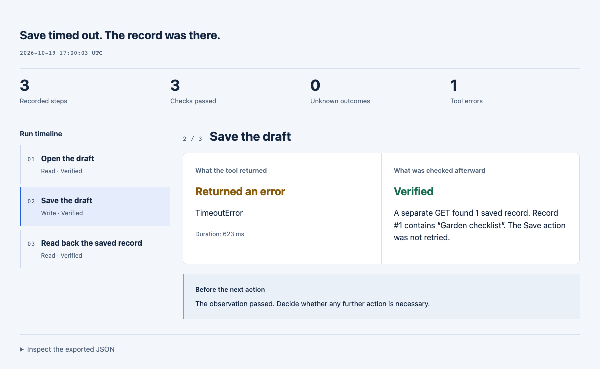

# StepReceipt

**“Save” timed out. Do you click it again?**

The error tells you what happened to the tool. You still need to know what happened on the page.

StepReceipt puts each browser action beside an explicit follow-up check, then turns the run into a standalone HTML report. A normal return stays **unknown** until you check it. A timeout can sit beside a successful readback. You can see both before deciding what to do next.

**[Open the live report](https://lydiatools.github.io/stepreceipt/)** · [中文说明](README.zh-CN.md) · [Download v0.1.0](https://github.com/LydiaTools/stepreceipt/releases/tag/v0.1.0)



*Captured from a real Playwright run against the included synthetic local fixture. It made one POST, saved one record, and never retried the write. This is a test scenario, not a production result.*

## Three things you can keep separate

| Question | What StepReceipt records |
| --- | --- |
| What did I ask the tool to do? | A named read or write, its timing, and its tool return status |
| What did I actually check? | An explicit observation marked `verified`, `rejected`, or `unknown` |
| What can I share for review? | A local JSON file and a self-contained HTML report, with English and Chinese controls |

The recorder calls each action once. It has no automatic retry or replay mechanism. Your code supplies the observation; StepReceipt does not independently prove it or prevent another part of your system from retrying.

## Quick start

Node.js 20+ is enough to render a report. No install, model, account, or API key is needed for this step:

```bash
git clone https://github.com/LydiaTools/stepreceipt.git
cd stepreceipt
node bin/stepreceipt.mjs examples/save-timeout.json --out receipt.html
```

Open `receipt.html` in your browser. You can also open a run JSON in the [online viewer](https://lydiatools.github.io/stepreceipt/). The viewer reads it in the page; there is no upload endpoint or analytics code. GitHub Pages still receives ordinary page requests.

The CLI refuses to overwrite an existing output file. Choose a new filename for another report.

## Run the browser example yourself

This example starts its own localhost fixture and a fresh, isolated browser. It does not connect to your signed-in Chrome session or a real site.

```bash
npm ci
npx playwright install chromium
npm run demo
```

If Google Chrome is already installed, you can use it without downloading a browser:

```bash
# macOS / Linux
BROWSER_CHANNEL=chrome npm run demo
```

PowerShell: `$env:BROWSER_CHANNEL="chrome"; npm run demo`.

Open `artifacts/demo/report.html`. The matching `run.json` contains the recorded tool error and the later observation. The expected fixture result is **one write request and one saved record**.

## Add it to your run

The recorder is a small ES module with zero runtime dependencies. Import it from this checkout:

```js
import { createReceipt } from './src/receipt.mjs';
import { renderReport } from './src/report.mjs';
import { writeFile } from 'node:fs/promises';

const receipt = createReceipt({ title: 'Save a draft' });
const step = await receipt.attempt(
  { label: 'Save the draft', kind: 'write' },
  async () => {
    await page.getByRole('button', { name: 'Save' }).click();
    await page.getByText('Saved successfully').waitFor();
  },
);

// Supply a separate read-only check, including after a tool error.
await receipt.verify(step.id, async () => {
  const found = await page.getByText('Draft #42').isVisible();
  return {
    status: found ? 'verified' : 'unknown',
    summary: found ? 'Draft #42 is visible.' : 'Draft #42 was not observed.',
  };
});

await writeFile('run.json', JSON.stringify(receipt.toJSON(), null, 2));
await writeFile('receipt.html', renderReport(receipt.toJSON()));
```

`attempt()` captures an action error and returns `{ id, ok, value }`; it does **not** rethrow the action error. Check `ok`, inspect the observation, and explicitly decide whether the workflow should continue. Observer errors remain `unknown`. Verifying a step a second time is rejected; record a new observation step if you need another check.

## What v0.1.0 is ready for

- Rendering your recorded actions and checks into a portable review report.
- Opening and exporting run JSON locally in a browser, with no backend.
- Trying the included real-browser timeout/readback fixture.
- Keeping raw error messages, stacks, page contents, and network traffic out of automatic capture. Only the error class is recorded.
- Redacting a few common credential patterns from exported text. This is heuristic redaction, not complete detection; labels and observations can still contain private information.

It is not a Playwright `trace.zip` viewer, a cryptographically signed audit trail, or a replacement for site-specific assertions. Native browser-use, Stagehand, Codex, and MCP adapters have **not** been tested. The JavaScript callback and JSON interfaces are the current integration points. The package is not published on npm.

## Development and evidence

```bash
npm test
# After installing a Playwright browser, or with BROWSER_CHANNEL=chrome:
npm run test:e2e
```

See [the run format](docs/FORMAT.md), [validation](docs/VALIDATION.md), and [why this small scope](docs/RESEARCH.md). The report shows observations supplied by the integration, including their limitations; it does not turn a claim into independent evidence.

If a report is misleading or an integration is hard to use, [open an issue](https://github.com/LydiaTools/stepreceipt/issues). Share a small synthetic example rather than a private session. If you want to follow the next integration, a Star is a useful way to keep track.

MIT. Built by [LydiaTools](https://github.com/LydiaTools). The related [Browser Agent Blueprint](https://github.com/LydiaTools/browser-agent-blueprint) contains prompt modules and local recovery scenarios; StepReceipt is the executable recorder and report tool.
