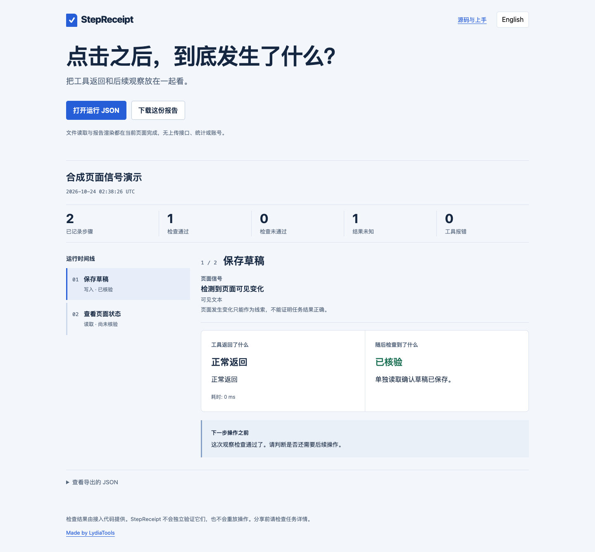

# StepReceipt · 浏览器 Agent 操作回执

**点了“保存”，工具却超时了。现在应该再点一次吗？**

工具报错时，页面上的操作可能已经完成。StepReceipt 把“工具返回了什么”和“随后检查到了什么”放在同一份报告里，方便你决定下一步。

**[直接打开演示](https://lydiatools.github.io/stepreceipt/)** · [Python browser-use 示例](docs/BROWSER-USE.zh-CN.md) · [Stagehand 示例](docs/STAGEHAND-INTEGRATION.zh-CN.md) · [English](README.md) · [下载发行版](https://github.com/LydiaTools/stepreceipt/releases/latest)


这张图来自真实 Playwright 本地测试：一次 POST 保存了一条记录，界面确认超时后，单独 GET 读取确认。测试没有重复保存，使用的是合成测试页，不是生产账号。

[查看三种结果的界面动图](docs/assets/three-outcomes.gif)：超时但已保存、错误成功提示、读回不可用。动图使用英文界面，回放三份已提交的本地合成测试报告；[录制与来源说明](docs/DEMO.md)可核对。

## 它能帮你做什么

- 分别记录动作、工具状态和后续观察。工具正常返回也不会自动算“已核验”。
- 可选记录一次 Playwright 动作前后的网址、标题、可见文本和控件数量变化；它们只是页面信号，不代表任务成功。
- 让检查结果明确落在“已核验 / 检查未通过 / 结果未知”三种状态。
- 导出独立 HTML，双击即可查看；界面可切换中英文。
- 在网页中打开自己的运行 JSON，文件在页面内读取，不上传到服务端。

每个动作只由记录器调用一次。工具不自动重试、不重放操作；你自己的外围流程仍需决定后续动作。检查函数由接入方编写，StepReceipt 不会独立证明检查结论。

## 先花一分钟看看结果

需要 Node.js 20+，这一步不需要安装依赖、模型或 Key：

```bash
git clone https://github.com/LydiaTools/stepreceipt.git
cd stepreceipt
node bin/stepreceipt.mjs examples/save-timeout.json --out receipt.html
```

打开 `receipt.html`。文件已存在时，命令会拒绝覆盖，请换一个输出文件名。

## 直接从 GitHub 安装 CLI 或库

项目目前没有发布到 npm 官方仓库。安装 Node.js 20+ 和 Git 后，可以直接安装 GitHub 上的当前源码：

```bash
npm install -g github:LydiaTools/stepreceipt
stepreceipt path/to/run.json --out receipt.html
```

在 Node.js 项目中使用记录器：

```bash
npm install github:LydiaTools/stepreceipt
```

```js
import { createReceipt } from 'stepreceipt';
import { renderReport } from 'stepreceipt/report';
```

安装地址明确指向 GitHub 仓库，不代表项目已发布到 npm registry。

要亲自跑浏览器测试：

```bash
npm ci
npx playwright install chromium
npm run demo
```

本机已有 Chrome 时，macOS/Linux 可执行 `BROWSER_CHANNEL=chrome npm run demo`，无需再下载浏览器。PowerShell 使用 `$env:BROWSER_CHANNEL="chrome"; npm run demo`。测试启动独立浏览器，不连接日常登录的 Chrome 账号。

结果位于 `artifacts/demo/`。JS 接入示例见 [英文说明](README.md#use-it-in-your-nodejs-project)。`attempt()` 捕获动作错误而不向外抛出，请检查返回的 `ok` 字段，再依据观察结果决定是否继续。

## 在 GitHub Actions 中使用检查结果

```bash
node bin/stepreceipt.mjs artifacts/demo/run.json --summary receipt-summary.md --check
```

命令输出 Markdown 摘要，可显示在 GitHub Actions 任务结果页。加上 `--check` 后：非空记录且所有观察都为 `verified` 返回 0；有 `rejected`、`unknown` 或空记录返回 1；输入、参数或输出错误返回 2。工具超时但读回已核验，可以通过。只生成报告、不加 `--check` 时，不执行这个判断。

它判断的是接入方记录的检查，不能代替独立验收，也无法识破接入方自己填写的错误结论。[接入示例与边界](docs/CI.md)。

`npm run test:e2e` 实际运行三组独立本地浏览器场景，每组只发送一次 POST：

| 场景和页面信号 | 单独读取结果 | 判断 | 查看真实报告 |
| --- | --- | --- | --- |
| 保存后界面确认超时；页面文本变化 | 一条匹配的记录 | 通过 | [保存超时](https://lydiatools.github.io/stepreceipt/) |
| 页面显示保存成功、存储实际失败；页面文本变化 | 没有记录 | 未通过 | [错误的成功提示](https://lydiatools.github.io/stepreceipt/cases/rejected-write.html) |
| 保存后超时、读取服务不可用；页面文本变化 | 无法读取记录数 | 未知，不通过 | [读回不可用](https://lydiatools.github.io/stepreceipt/cases/unknown-readback.html) |

仓库自身的 CI 已接入摘要和合成报告留存；反例必须返回 1，测试套件才算符合预期。


## Python browser-use：点击返回，不等于已经保存

可选桥接把真实的 `Tools.click` 返回与应用侧只读核对放在一起。四个原创本地案例覆盖禁用按钮、正常保存、错误成功提示和读回不可用。固定 browser-use 0.13.11 的四次点击都正常返回，核对结果依次是“不通过／通过／不通过／未知”；没有调用模型，不需要 API Key。

[运行四个案例](docs/BROWSER-USE.zh-CN.md) · [打开禁用按钮报告](https://lydiatools.github.io/stepreceipt/browser-use/disabled.html) · [Python 桥接](integrations/browser-use/stepreceipt_browser_use.py)


桥接不根据生成文本推断成功，也不会自动重试。这里实测原生工具调用和合成页面，没有实测模型驱动的 `Agent.run` 或生产网站。v0.6.0 起包含此示例，旧的固定发行包不包含。

## 真实 LangGraph 跨进程恢复

**流程正常返回，却留下两份相同的草稿。** 可选示例在业务提交后直接退出 Python 进程，再用新进程恢复同一任务。普通插入：2 次调用、2 条草稿；目标库唯一操作键：2 次调用、1 条草稿；正常完成对照组：1 次调用、1 条草稿。

[三组复现步骤](docs/LANGGRAPH.zh-CN.md) · [重复写入报告](https://lydiatools.github.io/stepreceipt/langgraph/crash-replay.html) · [目标库去重报告](https://lydiatools.github.io/stepreceipt/langgraph/target-dedup.html)。v0.3.0 已包含此示例；固定 v0.2.0 ZIP 早于该示例。去重由业务数据库负责，StepReceipt 负责记录与展示差别。


## 复现 LangGraph 检查点写入顺序竞态

**task write 仍被挂起时，更新的 checkpoint 已到达 saver 边界。** 在 LangGraph 1.2.17 的受控夹具中，恢复流程再次执行未完成动作，3 次都提交了第二个效果。示例还包含正常完成基线、先提交 task write 的顺序对照，以及稳定操作键对照。

[运行四个场景](docs/LANGGRAPH-SYNC-RACE.zh-CN.md) · [打开重复执行报告](https://lydiatools.github.io/stepreceipt/langgraph-sync-race/race-replay.html) · [English guide](docs/LANGGRAPH-SYNC-RACE.md)


这是参考 [LangGraph #8039](https://github.com/langchain-ai/langgraph/issues/8039) 编写的原创合成 SQLite 复现；该 Issue 已包含作者自己的复现。本项目补充了独立的事件门控运行、可分享报告和明确对照组；没有修改 LangGraph，也不表示上游认可。已有的[跨进程重启示例](docs/LANGGRAPH.zh-CN.md)覆盖另一种退出点，并独立固定依赖版本。

## 把恢复闸门和回执放进同一次浏览器运行

[Blueprint 整合示例](docs/BLUEPRINT-INTEGRATION.zh-CN.md) 把 Browser Agent Blueprint 的写前检查点接到 StepReceipt 的真实浏览器动作、独立读回、CLI 检查和 HTML 报告。它运行三组本地合成场景：草稿已保存但界面确认超时、读回失败必须保持未知、未加保护的重试造成重复。前两组会从磁盘把日志载入新控制器，再观察它是否拒绝再次写入。


[打开保存超时报告](https://lydiatools.github.io/stepreceipt/cases/blueprint-saved-timeout.html) · [打开读回未知报告](https://lydiatools.github.io/stepreceipt/cases/blueprint-unknown-readback.html) · [打开无保护重试报告](https://lydiatools.github.io/stepreceipt/cases/blueprint-unguarded-retry.html)

```bash
npm ci
npx playwright install chromium
npm run demo:blueprint -- --out artifacts/blueprint-demo
```

打开 `artifacts/blueprint-demo/` 下各场景的 `report.html` 和 `summary.md`。CI 还会真实打开英文/中文报告并截取桌面与手机视口。这里验证的是同一进程内创建新控制器后重载日志；真正跨进程终止与恢复见单独的 [LangGraph 示例](docs/LANGGRAPH.zh-CN.md)。本地夹具不能证明生产网站上的行为。

## 记录动作前后的页面信号

可选 Playwright 适配器会观察一次动作前后 URL、标题、可见文本和交互控件数量是否变化。报告只保存变化项名称，不保存网址、标题、页面文字或临时指纹。

```js
import { recordPageAction } from 'stepreceipt/playwright';

const step = await recordPageAction(receipt, page, {
  label: '保存草稿',
  kind: 'write',
  action: () => page.getByRole('button', { name: '保存' }).click(),
});

// 页面变化只是线索，任务结果仍需单独核验。
await receipt.verify(step.id, async () => {
  const saved = await page.getByText('草稿已保存').isVisible();
  return {
    status: saved ? 'verified' : 'unknown',
    summary: saved ? '独立检查通过。' : '没有观察到预期状态。',
  };
});
```

页面会在动作回调结束后立即采样。如果网站异步更新，请在回调里等待相关页面状态；`verified`、`rejected` 或 `unknown` 仍由单独的任务检查决定。采样失败不会阻止动作只运行一次；工具不会自动重试或重放。页面变化不能证明目标结果成功；页面看起来没变，也不排除后台已产生影响。[适配器说明与边界](docs/PLAYWRIGHT.zh-CN.md)。

[查看合成页面信号报告](https://lydiatools.github.io/stepreceipt/cases/page-signals.html)：页面可见变化仍由单独检查核验；页面未变化时，任务结果保持未知。配套截图：[英文](docs/assets/page-signals.png) · [中文](docs/assets/page-signals-zh.png)。



## 运行 Stagehand v4.3.0 示例

这个可选本地示例会记录两次 Stagehand Page 点击，并单独检查结果。它会展示“保存后页面有变化”和“点击返回但目标状态没变化”两种情况。示例使用 localhost 合成页面，不调用需要大模型的 `stagehand.act()`，不需要模型 Key 或 Browserbase 账号；Stagehand 不会成为 StepReceipt 的运行时依赖。

```bash
cd examples/stagehand
npm ci
npm run demo
```

需要 Node.js 22.18+ 和本机 Chrome 或 Chromium。[运行说明与结果边界](docs/STAGEHAND-INTEGRATION.zh-CN.md) · [English](docs/STAGEHAND-INTEGRATION.md)。

## 当前边界

已测试本地浏览器案例、JSON 导入、独立 HTML 导出再打开、移动端与中英文界面、Blueprint 整合、Playwright 信号适配器、Stagehand v4.3.0 Page 示例，以及 browser-use 0.13.11 工具层桥接。以上使用合成页面；模型驱动的 `stagehand.act()`、browser-use `Agent.run`、生产网站、Codex 和 MCP 原生整合尚未测试。当前不是 Playwright trace.zip 查看器，也尚未发布到 npm 或 PyPI；CLI 和 JavaScript 库可直接从 GitHub 安装。核心记录器仍无运行时依赖。

报告自动捕获错误类别，不自动记录错误正文、堆栈、页面内容或网络流量。导出文字会对少量常见凭据格式做脱敏，仍需检查自己填写的标题与观察说明。浏览器页面不含统计代码；在线演示托管于 GitHub Pages，会产生正常页面访问请求。

[测试证据](docs/VALIDATION.md) · [数据格式](docs/FORMAT.md) · [问题反馈](https://github.com/LydiaTools/stepreceipt/issues)

MIT 开源，个人项目由 [LydiaTools](https://github.com/LydiaTools) 维护。
