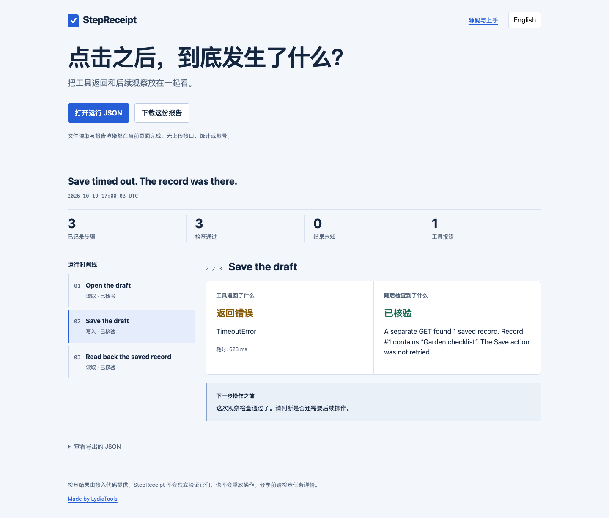

# StepReceipt · 浏览器 Agent 操作回执

**点了“保存”，工具却超时了。现在应该再点一次吗？**

工具报错时，页面上的操作可能已经完成。StepReceipt 把“工具返回了什么”和“随后检查到了什么”放在同一份报告里，方便你决定下一步。

**[直接打开演示](https://lydiatools.github.io/stepreceipt/)** · [English](README.md) · [下载 v0.1.0](https://github.com/LydiaTools/stepreceipt/releases/tag/v0.1.0)



这张图来自真实 Playwright 本地测试：一次 POST 保存了一条记录，界面确认超时后，单独 GET 读取确认。测试没有重复保存，使用的是合成测试页，不是生产账号。

## 它能帮你做什么

- 分别记录动作、工具状态和后续观察。工具正常返回也不会自动算“已核验”。
- 让检查结果明确落在“已核验 / 检查未通过 / 结果未知”三种状态。
- 导出独立 HTML，双击即可查看；界面可切换中英文。
- 在网页中打开自己的运行 JSON，文件在页面内读取，不上传到服务端。

每个动作只由记录器调用一次。工具不自动重试、不重放操作；你自己的外围流程仍需决定后续动作。检查函数由接入方编写，StepReceipt 不会独立证明检查结论。

## 先花一分钟看看结果

需要 Node.js 20+，这一步不需要安装依赖、模型或 Key：

```bash
git clone https://github.com/LydiaTools/stepreceipt.git
cd stepreceipt
node bin/stepreceipt.mjs examples/save-timeout.json --out receipt.html
```

打开 `receipt.html`。文件已存在时，命令会拒绝覆盖，请换一个输出文件名。

要亲自跑浏览器测试：

```bash
npm ci
npx playwright install chromium
npm run demo
```

本机已有 Chrome 时，macOS/Linux 可执行 `BROWSER_CHANNEL=chrome npm run demo`，无需再下载浏览器。PowerShell 使用 `$env:BROWSER_CHANNEL="chrome"; npm run demo`。测试启动独立浏览器，不连接日常登录的 Chrome 账号。

结果位于 `artifacts/demo/`。JS 接入示例见 [英文说明](README.md#add-it-to-your-run)。`attempt()` 捕获动作错误而不向外抛出，请检查返回的 `ok` 字段，再依据观察结果决定是否继续。

## 当前边界

已测试本地浏览器案例、JSON 导入、独立 HTML 导出再打开、移动端与中英文界面。尚未测试 browser-use、Stagehand、Codex 或 MCP 原生适配器。当前不是 Playwright trace.zip 查看器，也没有 npm 发包。

报告自动捕获错误类别，不自动记录错误正文、堆栈、页面内容或网络流量。导出文字会对少量常见凭据格式做脱敏，仍需检查自己填写的标题与观察说明。浏览器页面不含统计代码；在线演示托管于 GitHub Pages，会产生正常页面访问请求。

[测试证据](docs/VALIDATION.md) · [数据格式](docs/FORMAT.md) · [问题反馈](https://github.com/LydiaTools/stepreceipt/issues)

MIT 开源，个人项目由 [LydiaTools](https://github.com/LydiaTools) 维护。
