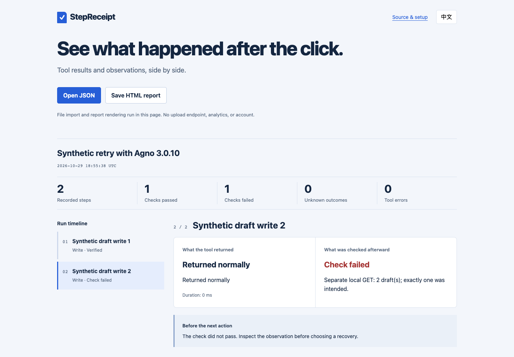

# Two successful tool returns, then two drafts

[中文](AGNO-RETRY.zh-CN.md) · [Example source](../examples/agno/)

A tool returns successfully. A later model request fails. When the entire agent run is retried, what happens to the first write?

This optional fixture runs **Agno 3.0.10** and **OpenAI SDK 3.16.2** with one synthetic agent invocation. A local scripted model sends a tool call, then HTTP 500; the run retries once and the sequence repeats. The SDK's own retries are disabled. A synthetic business server accepts both tool calls; StepReceipt records the writes on that server and a separate local GET checks the number of records.

| Observation | Result in this fixture |
| --- | --- |
| Scripted model requests | 4: tool call, 500, tool call, 500 |
| Synthetic tool returns | Two HTTP 201 responses |
| Business writes / final GET | 2 / 2 synthetic drafts |
| Recorded checks | First `verified`, second `rejected`: the supplied requirement was exactly one draft |
| Agent return | `agent.run()` returned without raising; `result.status` was `RunStatus.error` |
| StepReceipt `--check` | Exit 1, because one supplied observation was rejected |



*Actual report from the local synthetic fixture, with the second write selected.*

This recreates the specific successful-tool-then-later-failure shape described in [Agno #10366](https://github.com/agno-agi/agno/issues/10366) with original fixture code. It does not test the reporter's environment, a real model, production endpoint or current upstream main.

## Run the example

Use current repository source, Node.js 20+ and Python 3.12. The fixed v0.8.0 release predates this example. Install the pinned optional dependencies in a new virtual environment; installation requires network access. The fixture itself uses only a local HTTP server and a synthetic API key.

```bash
python3.12 -m venv .venv-agno
.venv-agno/bin/python -m pip install -r examples/agno/requirements.txt
node examples/agno/run.mjs --python .venv-agno/bin/python --out artifacts/agno-run-1
node bin/stepreceipt.mjs artifacts/agno-run-1/run.json --check --summary artifacts/agno-run-1/summary.md
```

The runner returns 0 when it observes the expected two writes. The last command deliberately returns 1 because the second check is rejected. Open `artifacts/agno-run-1/report.html`, `observation.json`, and `summary.md`. A new output directory is required on each run; existing directories are never overwritten.

The child process receives a separate HOME, an environment allowlist, disabled Agno telemetry, and application-level loopback socket/DNS guards. These guards are fixture protections, **not an OS sandbox**. The in-memory business server binds only `127.0.0.1`; the fixture does not connect to a real provider or use user credentials.

## What the report means

StepReceipt records the local server's successful write operations, not the native Agno tool function itself. The integration supplies each GET observation and the exactly-one-record requirement; StepReceipt does not infer whether two operations represent the same business action, prevent retries, or deduplicate writes. This is a narrow executable example, not a generic Agno adapter, an upstream fix, or an exactly-once guarantee.
