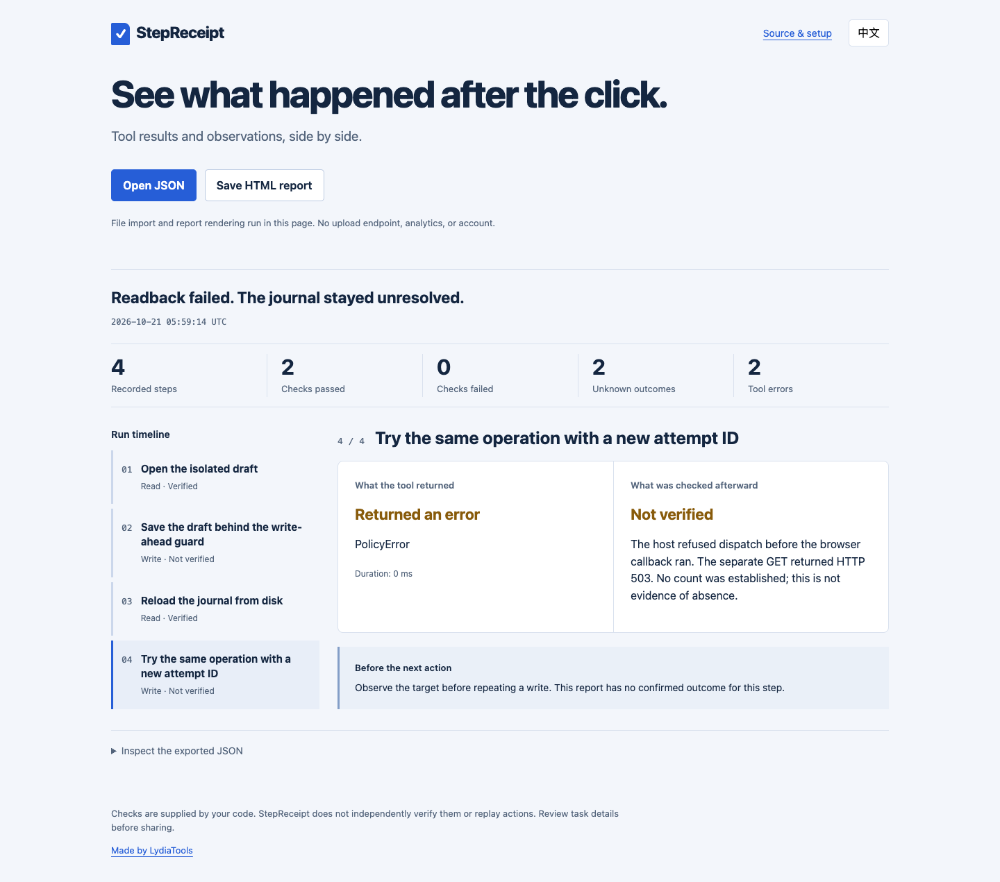
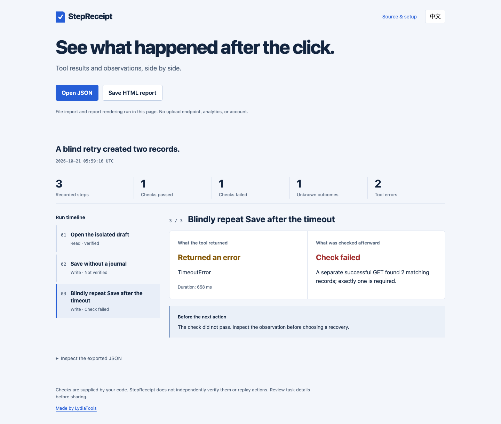

# Browser Agent Blueprint + StepReceipt

这个可选示例把 [Browser Agent Blueprint](https://github.com/LydiaTools/browser-agent-blueprint/tree/630d773c44cc41f35128d14344a77339906b9504) 固定版本的 `Controller` 接到真实 Playwright 操作、StepReceipt 运行记录、CLI 检查和 HTML 报告。它只访问本机回环地址上的合成 HTTP 服务，不登录账号、不访问外部网站、不调用模型，也不宣称已证明生产可靠性。

## 运行

需要 Node.js 20+、npm 和 Chromium。从仓库根目录执行：

```bash
npm ci
npx playwright install chromium
npm run demo:blueprint -- --out artifacts/blueprint-demo
```

如果已经安装 Chrome，可在最后一条命令前设置 `BROWSER_CHANNEL=chrome`。输出目录必须是新目录。每组场景会生成 `run.json`、`report.html`、`summary.md` 和 `evidence.json`；有保护的场景还会保留检查点及超时后的检查点副本。可在本机浏览器中打开 HTML 报告。

运行包含断言和离线报告截图的验收：

```bash
npm run test:blueprint
```

CI 会使用干净的 `artifacts/blueprint/` 目录，并保留七天报告和截图。脚本不会覆盖已有输出目录。

## 三组场景验证什么

| 场景 | 本地实际发生的动作 | StepReceipt 结果 |
| --- | --- | --- |
| `saved-timeout` | 浏览器只提交一次保存。服务端保存一条记录，但页面确认等待超时；单独 GET 查到恰好一条。新建的控制器从磁盘加载校验过的检查点后，拒绝用新尝试 ID 重复同一操作。 | 超时和读回确认分别记录；最终检查闸门通过。 |
| `unknown-readback` | 浏览器只提交一次保存。单独 GET 返回 HTTP 503，主机无法确认记录数。新控制器载入检查点后，在结果未决时拒绝重放。 | 结果保持 `unknown`；检查闸门阻止通过。 |
| `unguarded-retry` | 故意不使用保护控制器的反例连续提交两次保存，夹具实际留下两条记录。 | “必须恰好一条”的检查失败，闸门阻止通过。 |

## 实际生成的报告

以下截图来自刚生成的本地报告，没有改写运行数据：


[打开保存超时报告](cases/blueprint-saved-timeout.html)



[打开读回未知报告](cases/blueprint-unknown-readback.html)



[打开无保护重试报告](cases/blueprint-unguarded-retry.html)

夹具会在每次受保护的 POST 到达时，实际读取磁盘检查点并记录其状态为 `DISPATCHED`。主机不会通过服务端私有计数器伪装独立读回成功。在 `unknown-readback` 场景中，服务端内部状态不会暴露给主机观察函数。

恢复过程是在**同一个操作系统进程**中创建新控制器对象并重载检查点。本示例不测试进程终止或工作进程恢复；相关测试见独立的 [LangGraph 跨进程恢复示例](LANGGRAPH.zh-CN.md)。未保护的反例有意绕过 Blueprint 控制器，才能展示无保护重试造成的结果。

依赖固定为 Blueprint 提交 `630d773c44cc41f35128d14344a77339906b9504`。这是连接两个库的测试示例，不统计用户采用，不阻止其它代码自行重试，也不证明第三方网站保存了什么。
